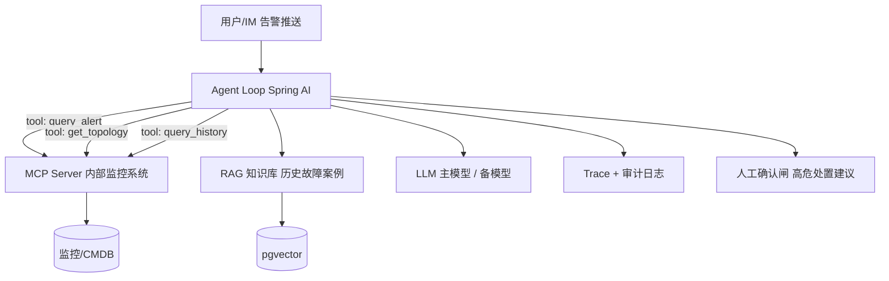
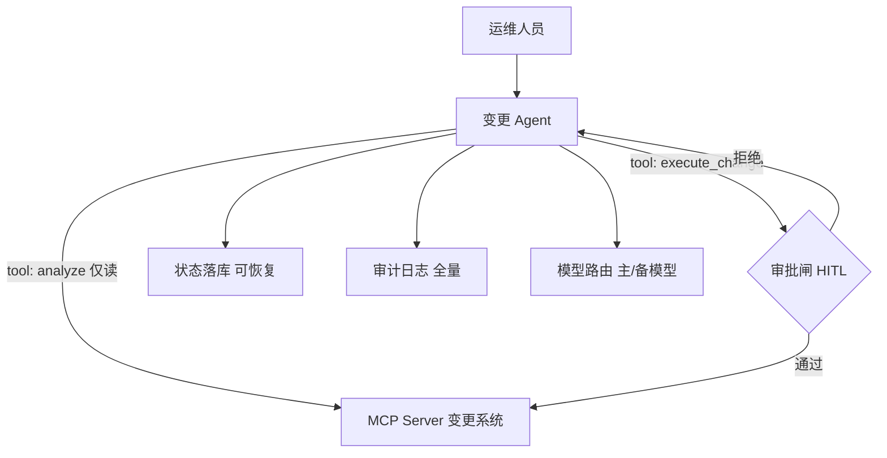
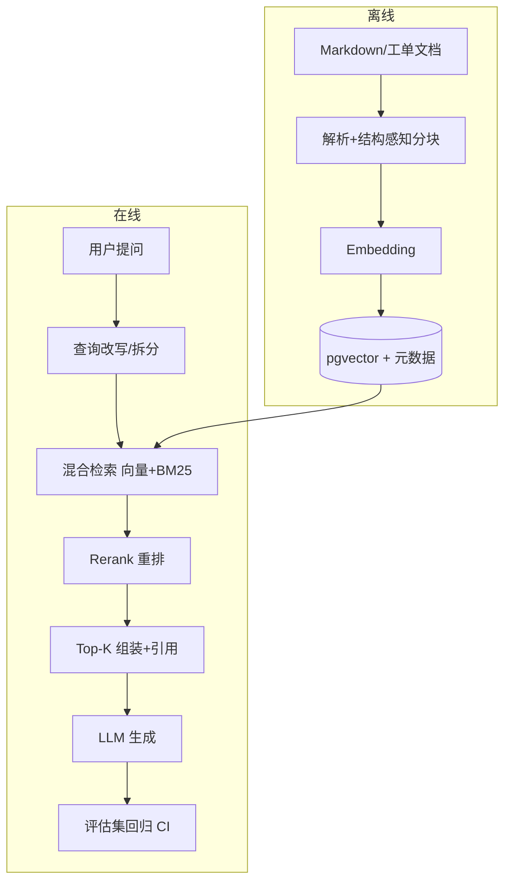

# 八、实战项目指南

三个实战项目均复用你在**告警、云网变更、运营保障**系统的领域知识，与学习周次对齐（第 6 周起）。每个项目给出：目标、架构、模块拆解、里程碑、验收标准、简历表述。建议按顺序做，前一个是后一个的地基。

## 项目一：告警关联分析 Agent

**对应周次**：第 6 周（MCP）+ 第 7–8 周（可观测/评估） | **难度**：★★☆

### 1.1 目标

输入一条/一批告警，Agent 自动：查询告警明细 → 关联拓扑与历史 → 给出**根因推测 + 影响面 + 处置建议**，全程带引用与置信说明，高危建议走人工确认。

### 1.2 架构

### 1.3 模块拆解

| 模块         | 内容                                            | 对应分册 |
|--------------|-------------------------------------------------|----------|
| MCP Server   | 封装 query_alert / get_topology / query_history | 04       |
| Agent Loop   | ReAct 循环、预算与迭代限制、工具结果裁剪        | 02       |
| RAG 知识库   | 历史故障案例入库 + 混合检索 + 引用              | 03       |
| 可观测与审计 | Langfuse trace、token 成本、操作审计            | 05       |
| Guardrails   | 注入检测、建议分级（只读分析/高危操作审批）     | 05       |

### 1.4 里程碑

1. **M1（1 周）**：MCP Server 可查告警，Inspector 联调通过；
2. **M2（1 周）**：Agent 多步链路跑通（查告警→查拓扑→给建议），带引用；
3. **M3（1 周）**：接 RAG 历史案例 + trace + 评估报告（10 条典型告警的输出评分）。

### 1.5 验收标准

- [ ] 单条告警 → 根因建议的完整链路可演示，端到端 ≤ 30s；
- [ ] 每条结论可溯源（工具数据 / 检索案例）；
- [ ] 有评估报告：建议合理性人工评分 ≥ 可用线；
- [ ] 迭代/token 预算生效，异常路径（工具超时）优雅降级。

### 1.6 简历表述（示例）

> 设计并实现告警关联分析 Agent：基于 MCP 协议封装监控系统查询工具，ReAct 多步推理完成告警→拓扑→历史案例的根因分析，结合 RAG 携带引用输出处置建议；接入 OpenTelemetry/Langfuse 全链路追踪与 token 成本核算，建立 10 例评估集与高危建议人工审批闸。

## 项目二：变更操作 Agent（含审批流）

**对应周次**：第 6–8 周 | **难度**：★★★

### 2.1 目标

把"云网变更"场景做成**人机协同**的 Agent：Agent 负责只读分析（方案校验、影响面评估、历史比对），**执行类操作必须走人工审批**，审批通过才真正调用变更接口。

### 2.2 架构

### 2.3 关键设计（企业级要点）

1. **读写分离的工具集**：`analyze_*` 只读工具模型可自主调用；`execute_*` 写工具一律过审批闸；
2. **状态落库**：审批等待可能持续数小时/天，Agent 状态（消息、工具调用、审批状态）必须持久化，进程重启可恢复；
3. **幂等**：变更执行带幂等键，网络超时重试不重复下发；
4. **审计可回放**：谁、何时、依据什么数据、执行了什么变更、审批人是谁；
5. **降级**：主模型不可用 → 备模型；备模型不可用 → 只读分析仍可用，执行类明确拒绝并提示。

### 2.4 里程碑

1. **M1（1 周）**：只读分析链路（方案校验 + 影响面）跑通；
2. **M1.5（3 天）**：审批闸 + 状态落库 + 拒绝回填；
3. **M2（1 周）**：幂等、降级演练、审计回放、评估集。

### 2.5 验收标准

- [ ] 写操作 100% 经过审批闸（代码级保证，而非提示词约束）；
- [ ] kill 进程后审批任务可恢复，不丢状态；
- [ ] 人为注入主模型故障，降级链生效且有告警；
- [ ] 任一历史会话可完整回放（trace + 审计）。

### 2.6 简历表述（示例）

> 主导变更操作 Agent：设计读写分离工具集与 Human-in-the-Loop 审批闸（写操作代码级强制审批），Agent 状态落库支持断点恢复，变更执行幂等化并支持多模型降级；全量审计日志实现会话级回放，满足变更操作合规要求。

## 项目三：企业知识库问答（RAG + 评估）

**对应周次**：第 4 周起步、第 8 周收尾 | **难度**：★★☆

### 3.1 目标

基于你现有的笔记/文档体系（本站 `static/` 下的笔记与项目文档就是现成语料），做一个**带引用、可评估、权限受控**的知识库问答 Agent。

### 3.2 架构

### 3.3 里程碑

1. **M1（1 周）**：索引管道 + 相似度检索 + 带引用回答；
2. **M2（1 周）**：混合检索 + Rerank + 50 条 golden set + 基线报告；
3. **M3（0.5 周）**：权限过滤（元数据级）、CI 回归门禁、一次分块 A/B 对比。

### 3.4 验收标准

- [ ] 每个答案附来源文档与章节，引用可点击核对；
- [ ] 有基线评估报告：context_recall / faithfulness 数字齐全；
- [ ] 一次 A/B（如分块策略）有前后对比数字；
- [ ] 检索按权限过滤，非授权文档不进入上下文。

### 3.5 简历表述（示例）

> 构建企业知识库问答系统：结构感知分块 + 混合检索（向量+BM25）+ Rerank 管道，答案逐句引用溯源；基于 50 条 golden set 建立 RAGAS 评估与 CI 回归门禁，通过分块策略 A/B 将召回率提升 X%；检索层实现租户级权限过滤。

## 项目通用验收清单（三个项目共用）

- [ ] **有评估**：golden set + 分数，改动前后可对比；
- [ ] **有追踪**：任一请求能看到完整 trace 树与 token 成本；
- [ ] **有护栏**：注入检测 + 工具权限 + 输出校验三层到位；
- [ ] **有兜底**：预算熔断、模型降级、工具失败路径都演练过；
- [ ] **有文档**：架构图、取舍记录、README 可让新人看懂；
- [ ] **能讲述**：3 分钟讲清架构，5 分钟讲清一个关键取舍。

## 学习与项目周次对照

| 周次 | 知识主线 | 项目动作                        |
|------|----------|---------------------------------|
| 1–3  | 01–02 册 | 项目三的语料准备（整理文档）    |
| 4    | 03 册    | 项目三 M1–M2（索引 + 评估基线） |
| 5    | 04 册    | 项目一/二的 Server 设计稿       |
| 6    | 04 册    | 项目一 M1–M2；项目二 M1         |
| 7    | 05 册    | 项目一 M3；项目二 M1.5          |
| 8    | 05 册    | 项目二 M2；项目三 M3 收尾       |
