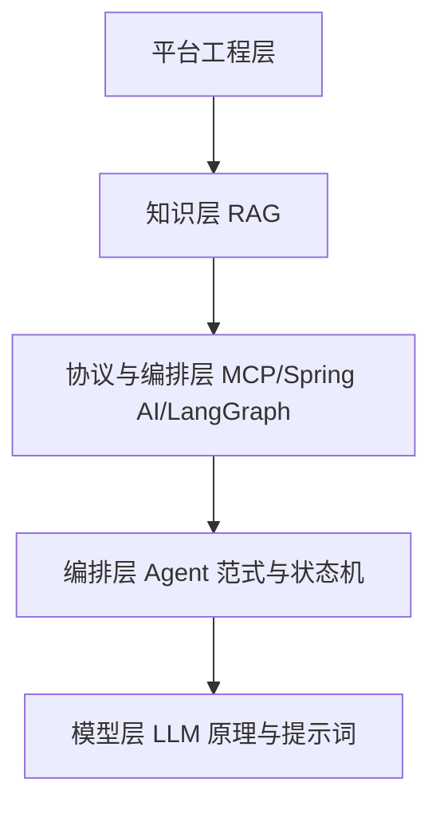

# AI Agent 企业级开发学习指南

本指南面向具备 Java 后端经验的开发者，目标是系统掌握 AI Agent 开发并达到**企业级落地水平**。技术栈主线为 **Java + Spring AI**，同时覆盖 Python 生态（LangGraph 等）以对照理解原理。按每周 10+ 小时投入，约 8 周走完主线。

## 一、能力分层

企业级 Agent 开发需要打通五个层次：

| 层次         | 核心内容                                                       | 对应分册 |
|--------------|----------------------------------------------------------------|----------|
| 模型层       | LLM 原理、上下文窗口、结构化输出、Function Calling、提示词工程 | 01       |
| 编排层       | Agent Loop、ReAct/Plan-and-Execute、多智能体、上下文工程       | 02       |
| 知识层       | RAG 全链路：分块、Embedding、向量库、混合检索、评估            | 03       |
| 协议与框架层 | MCP/A2A 协议、Spring AI 主线、LangGraph 对照                   | 04       |
| 平台工程层   | 可观测性、评估体系、安全、可靠性、平台化                       | 05       |

**分水岭说明**：demo 到生产的差距主要体现在第 05 册（平台工程）和第 02 册的上下文工程，这两部分是企业级能力的核心区分点。

## 二、五阶段路线图

| 阶段   | 主题                             | 周期（10+ h/周） | 产出                               |
|--------|----------------------------------|------------------|------------------------------------|
| 阶段一 | 地基：LLM 原理 + 提示词工程      | 第 1 周          | 提示词版本管理样例、结构化输出实验 |
| 阶段二 | Agent 核心范式 + 手写 Agent Loop | 第 2–3 周        | 纯 Java 手写 Agent 框架（无依赖）  |
| 阶段三 | RAG 知识层                       | 第 4 周          | 可评估的知识库问答原型 + 评估报告  |
| 阶段四 | MCP 协议 + Spring AI 框架        | 第 5–6 周        | 自研 MCP Server 接入内部系统       |
| 阶段五 | 企业级工程化                     | 第 7–8 周        | 具备追踪/评估/护栏的准生产 Agent   |

阶段之间有依赖关系：阶段二是全程骨架，阶段四的 Spring AI 是阶段二原理的工程化封装，阶段五贯穿在每个实战项目中验收。

## 三、分册导航

| 分册 | 文件                                                   | 说明                               |
|------|--------------------------------------------------------|------------------------------------|
| 00   | [README.md](README.md)                                 | 总览、路线图、学习方法（本文件）   |
| 01   | [01-LLM基础与提示词工程.md](01-LLM基础与提示词工程.md) | 模型层地基与提示词工程             |
| 02   | [02-Agent核心范式.md](02-Agent核心范式.md)             | Agent Loop、经典范式、上下文工程   |
| 03   | [03-RAG知识层.md](03-RAG知识层.md)                     | RAG 全链路与评估                   |
| 04   | [04-MCP协议与框架选型.md](04-MCP协议与框架选型.md)     | MCP/A2A 协议、Spring AI、LangGraph |
| 05   | [05-企业级工程化.md](05-企业级工程化.md)               | 可观测、评估、安全、可靠性、平台化 |
| 06   | [06-进阶选修.md](06-进阶选修.md)                       | 记忆、多智能体、Coding Agent、微调 |
| 07   | [07-八周学习计划.md](07-八周学习计划.md)               | 按周拆解的进度表与自检清单         |
| 08   | [08-实战项目指南.md](08-实战项目指南.md)               | 3 个结合运维背景的实战项目         |
| 09   | [09-学习资源清单.md](09-学习资源清单.md)               | 全量资源清单（按阶段、标注优先级） |

**建议阅读顺序**：按 01 → 09 编号顺序精读；07 是执行时的进度表；08 是学完 01–05 后的实战载体；09 是各分册"学习资源"小节的汇总与扩展。

## 四、学习方法建议

1. **先原理后框架**：阶段二手写 Agent Loop 是全程最关键的一步，避免"框架会了原理不会"。用 Spring AI 之前，先能用纯 Java 解释清楚一次工具调用循环的每一步。
2. **每周有产出物**：进度以"写出来的东西"衡量（代码、评估报告、MCP Server），而不是"看过的资料"。每周产出物见 07 分册。
3. **评估驱动**：从阶段三开始就建立评估集，没有评估的 RAG 和 Agent 无法上生产。
4. **资源不过度收集**：每个阶段的"学习资源"小节只列必读优先的内容，按优先级消化，避免囤积。
5. **结合自身背景**：08 分册的三个项目复用你在告警、变更、运维保障系统上的领域知识，这是差异化优势。

## 五、技术栈约定

- **主线**：Java 17+ / Spring Boot 3 / Spring AI 1.x，JDK 与框架具体版本以官方文档为准。
- **对照**：Python 3.11+ / LangGraph，用于理解状态机编排的另一实现。
- **协议**：MCP（Model Context Protocol）、A2A（Agent2Agent）。
- **基础设施**：PostgreSQL（pgvector）或 Elasticsearch（向量检索）、Redis（缓存）、OpenTelemetry + Langfuse（追踪）。
- 本指南不写死框架小版本号，API 细节以官方文档为准。
