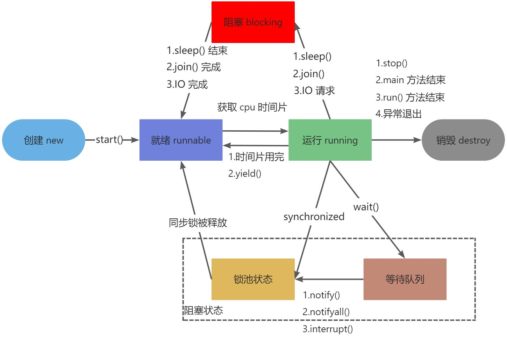

#### 进程与线程

一个进程中至少有一个线程，进程中的多个线程共享进程的资源
- 进程是系统进行资源分配和调度的基本单位
- 线程是进程的一个执行路径

|          | 进程                                       | 线程                                                       |
|----------|--------------------------------------------|------------------------------------------------------------|
| 资源分配 | 资源分配的基本单位，拥有独立地址空间       | 不分配资源，共享所属进程的堆、方法区、文件句柄等           |
| CPU 调度 | 传统模型中的调度单位                       | 现代 OS 中线程是 CPU 调度与执行的基本单位                  |
| 开销     | 创建/销毁/切换需切换页表、刷新缓存，开销大 | 只需保存寄存器与栈，切换开销远小于进程                     |
| 通信     | 管道、信号、共享内存、Socket               | 共享变量（volatile/synchronized）、wait/notify、锁、管道流 |
| 隔离性   | 一个进程崩溃通常不影响其他进程             | 一个线程异常（如未捕获）会导致整个进程崩溃                 |

- 线程上下文切换要保存/恢复寄存器、栈等信息，仍有开销，高并发下应控制线程数量（复用线程）


#### 纤程（Fiber）与协程（Coroutine）

**纤程（Fiber）**：用户态调度的轻量级线程。调度不由内核完成，而是由用户程序或语言运行时的调度器在**用户态**完成，切换时不发生系统调用、不陷入内核态，开销远小于线程的上下文切换。

- 一个内核线程上可以挂载多个纤程，纤程数量不受内核线程数限制（平台线程栈通常约 1MB，纤程初始栈仅几 KB 且可动态扩容）
- **Java 中的纤程即虚拟线程**：Project Loom 早期原型 API 就是 `java.lang.Fiber`，正式发布时定名**虚拟线程**（Virtual Thread，JDK 19 预览、JDK 21 正式，JEP 444）——平时说的"Java 纤程"通常指虚拟线程
- 同类思想：Go 的 goroutine、Kotlin 的协程、Erlang 的进程

**纤程与协程的区别（视角不同，日常常混用）**：

- **纤程**强调**调度归属**：谁来调度（用户态 vs 内核态），是线程模型层面的实现
- **协程**强调**协作方式**：可在挂起点暂停、保存局部状态，稍后恢复继续执行；由程序主动让出控制权（协作式），不依赖时间片抢占
- Java 的选择是虚拟线程（纤程），而非语言级协程（Kotlin 有语言级 `suspend` 协程）

**平台线程 vs 虚拟线程（M:N 模型）**：

|          | 平台线程                   | 虚拟线程（Java 纤程）                                 |
|----------|----------------------------|-------------------------------------------------------|
| 调度模型 | 1:1，OS 内核调度           | M:N，JVM 用户态调度器把大量虚拟线程映射到少量平台线程 |
| 切换开销 | 系统调用、陷入内核，开销大 | 用户态完成，开销极小                                  |
| 数量     | 受栈内存限制，数千~万级    | 百万级，初始栈 KB 级、按需扩容                        |
| 阻塞代价 | 阻塞即浪费一个 OS 线程     | 挂起时把载体平台线程让出来跑其他虚拟线程，载体不浪费  |
| 适用场景 | CPU 密集                   | IO 密集（网络等待、磁盘 IO）                          |

```java
// 创建虚拟线程
Thread.ofVirtual().start(() -> handle(conn));

// 每任务一个虚拟线程（替代线程池的常见用法）
try (var executor = Executors.newVirtualThreadPerTaskExecutor()) {
    executor.submit(() -> queryDb());
}
```

注意：

- 虚拟线程**不是并行**：仍是少量平台线程在跑，CPU 密集任务开再多虚拟线程也不会更快
- **Pinning（钉住）**：JDK 21 中虚拟线程进入 `synchronized` 块时会钉住载体线程无法让出，临界区长或调用 native 方法时建议用 `ReentrantLock`（JDK 24 起已修复 synchronized 钉住问题）
- 阻塞 API（`Thread.sleep`、`wait`、锁等待）在虚拟线程上只挂起虚拟线程本身，载体会被调度器复用


#### 操作系统的五个进程状态与Java的六个线程状态

**操作系统五种进程状态**：

```
创建 ──→ 就绪 ←──→ 运行 ──→ 终止
           ↑↓
          阻塞
```

1. **创建**：进程 PCB 创建中，尚未进入就绪队列
2. **就绪**：除 CPU 外的资源均已备齐，等待调度
3. **运行**：被调度器选中，占用 CPU 执行
4. **阻塞**：等待某事件（IO、锁、信号）完成，让出 CPU
5. **终止**：执行完毕或异常退出，系统回收资源

转换关系：
- 就绪 → 运行：被调度器选中
- 运行 → 就绪：时间片用完
- 运行 → 阻塞：请求资源/IO 等待事件（主动挂起）
- 阻塞 → 就绪：事件完成，重新进入就绪队列排队

**与 Java `Thread.State` 六态对照**：

| 操作系统状态 | Java 状态     | 说明                                                         |
|--------------|---------------|--------------------------------------------------------------|
| 创建         | NEW           | `new Thread()` 后、`start()` 前                              |
| 就绪 + 运行  | RUNNABLE      | Java 不再细分：是否真正在 CPU 上执行由 OS 调度，JVM 无法感知 |
| 阻塞         | BLOCKED       | 仅指竞争 `synchronized` monitor 锁失败                       |
| 阻塞         | WAITING       | 无限期等待：`wait()`、`join()`、`park()`                     |
| 阻塞         | TIMED_WAITING | 限时等待：`sleep(ms)`、`wait(ms)`、`join(ms)`、`parkNanos`   |
| 终止         | TERMINATED    | `run()` 结束                                                 |

- OS 的"阻塞"在 Java 中按**等待原因**拆成三种：monitor 等待、无限期等待、限时等待
- `ReentrantLock` 等 AQS 锁竞争失败**不是** BLOCKED（park 挂起），表现为 WAITING


#### 线程的生命周期和状态

在 Java 中线程没有 running 这个状态（RUNNABLE 包含操作系统的就绪与运行，由 OS 调度，JVM 无法区分）
```java
public enum State {
    /**
     * Thread state for a thread which has not yet started.
     */
    NEW,

    /**
     * Thread state for a runnable thread.  A thread in the runnable
     * state is executing in the Java virtual machine but it may
     * be waiting for other resources from the operating system
     * such as processor.
     */
    RUNNABLE,

    /**
     * Thread state for a thread blocked waiting for a monitor lock.
     * A thread in the blocked state is waiting for a monitor lock
     * to enter a synchronized block/method or
     * reenter a synchronized block/method after calling
     * {@link Object#wait() Object.wait}.
     */
    BLOCKED,

    /**
     * Thread state for a waiting thread.
     * A thread is in the waiting state due to calling one of the
     * following methods:
     * <ul>
     *   <li>{@link Object#wait() Object.wait} with no timeout</li>
     *   <li>{@link #join() Thread.join} with no timeout</li>
     *   <li>{@link LockSupport#park() LockSupport.park}</li>
     * </ul>
     *
     * <p>A thread in the waiting state is waiting for another thread to
     * perform a particular action.
     *
     * For example, a thread that has called <tt>Object.wait()</tt>
     * on an object is waiting for another thread to call
     * <tt>Object.notify()</tt> or <tt>Object.notifyAll()</tt> on
     * that object. A thread that has called <tt>Thread.join()</tt>
     * is waiting for a specified thread to terminate.
     */
    WAITING,

    /**
     * Thread state for a waiting thread with a specified waiting time.
     * A thread is in the timed waiting state due to calling one of
     * the following methods with a specified positive waiting time:
     * <ul>
     *   <li>{@link #sleep Thread.sleep}</li>
     *   <li>{@link Object#wait(long) Object.wait} with timeout</li>
     *   <li>{@link #join(long) Thread.join} with timeout</li>
     *   <li>{@link LockSupport#parkNanos LockSupport.parkNanos}</li>
     *   <li>{@link LockSupport#parkUntil LockSupport.parkUntil}</li>
     * </ul>
     */
    TIMED_WAITING,

    /**
     * Thread state for a terminated thread.
     * The thread has completed execution.
     */
    TERMINATED;
}
```


**状态转换与触发方法**：

| 当前状态      | 目标状态      | 触发动作                                                   |
|---------------|---------------|------------------------------------------------------------|
| NEW           | RUNNABLE      | `start()`                                                  |
| RUNNABLE      | BLOCKED       | 竞争 `synchronized` 锁失败                                 |
| RUNNABLE      | WAITING       | `wait()`（须持有该对象锁）、`join()`、`LockSupport.park()` |
| RUNNABLE      | TIMED_WAITING | `sleep(ms)`、`wait(ms)`、`join(ms)`、`parkNanos/parkUntil` |
| BLOCKED       | RUNNABLE      | 获得 monitor 锁                                            |
| WAITING       | RUNNABLE      | `notify()/notifyAll()`、被 join 的线程终止、`unpark()`     |
| TIMED_WAITING | RUNNABLE      | 等待超时、被唤醒、`interrupt()`                            |
| RUNNABLE      | TERMINATED    | `run()` 正常返回，或抛出未捕获异常                         |

关键区别：**`sleep` 不释放锁；`wait` 会释放锁**（因此必须在同步块中、持有该对象锁时调用）


#### 初始化线程的方式有哪几种？

1. 继承 `Thread` ，Thread 类在底层也是实现 Runnable 接口（缺点：Java 单继承限制；无法配合线程池复用）
2. 实现 `Runnable` 接口 
3. 实现 `Callable` 接口 + `FutureTask` 可以拿到返回结果，可以处理异常，但是不利于控制服务器中的线程资源，可能导致服务器资源耗尽。
4. 线程池 `ExecutorService`可以控制资源，性能稳定，也可以获取执行结果，并捕获异常（在业务复杂情况下，一个异步调用可能会依赖与另一个异步调用的执行结果）

实际开发中推荐方式 4：用线程池提交 `Runnable`/`Callable`，避免手动 `new Thread` 导致线程数量失控。


#### sleep、wait、join、yield 的区别？

|            | sleep                  | wait                             | join                                     | yield                          |
|------------|------------------------|----------------------------------|------------------------------------------|--------------------------------|
| 所属       | `Thread` 静态方法      | `Object` 实例方法                | `Thread` 实例方法                        | `Thread` 静态方法              |
| 是否释放锁 | 否                     | 是（释放对象监视器）             | 否                                       | 否                             |
| 使用条件   | 任意位置               | 必须进入该对象的同步块并持有其锁 | 通常在持有锁时调用（`join` 内部 `wait`） | 任意位置                       |
| 唤醒条件   | 超时或被 `interrupt()` | `notify()/notifyAll()` 或超时    | 被 join 的线程终止，或超时               | 立即结束，重新参与 CPU 竞争    |
| 状态       | TIMED_WAITING          | WAITING / TIMED_WAITING          | WAITING / TIMED_WAITING                  | 保持 RUNNABLE，不进入挂起      |
| 用途       | 当前线程暂停一段时间   | 线程间通信，等待被唤醒           | 等待另一线程执行完                       | 提示调度器让出 CPU（可能无效） |

**sleep 与 wait 的区别（高频）**：

1. **所属类**：`Thread` 静态方法 vs `Object` 实例方法
2. **是否释放锁**：`sleep` 不释放锁（其他线程仍无法进入该同步块）；`wait` 释放锁
3. **使用条件**：`sleep` 任意位置可调用；`wait` 必须持有该对象的锁（在同步块内）
4. **用途**：`sleep` 是线程自身暂停；`wait` 用于线程间协作，等待 notify 唤醒


#### 说说你对守护线程的理解？

- 通过 `thread.setDaemon(true)` 设置，**必须在 `start()` 之前**调用，否则抛 `IllegalThreadStateException`
- 守护线程为其他线程提供后台服务；**JVM 中只剩守护线程时立即退出**，不等待守护线程执行完毕，因此守护线程的 `finally` 块不保证执行
- 主线程默认是非守护线程；GC 线程是典型的守护线程
- 适用场景：心跳检测、监控上报、缓存清理等辅助任务；核心业务不能放守护线程


#### 线程之间如何通讯？

1. **共享变量 + volatile/synchronized**：保证可见性与有序性，配合标志位（如 `volatile boolean stop`）
2. **wait/notify/notifyAll**：`Object` 监视器方法，必须在同步块中持有该对象锁，由另一线程唤醒
3. **Lock + Condition**：`await()/signal()`，可绑定多个条件实现精确唤醒（见 [ReentrantLock](/doc/juc/ReentrantLock原理.md)）
4. **管道流**：`PipedInputStream`/`PipedOutputStream` 在线程间直接传递字节流
5. **线程中断**：`interrupt()`、`isInterrupted()`、`InterruptedException` 协作取消线程
6. **JUC 同步工具**：`Thread.join()`、`CountDownLatch`、`CyclicBarrier`、`Exchanger` 等
