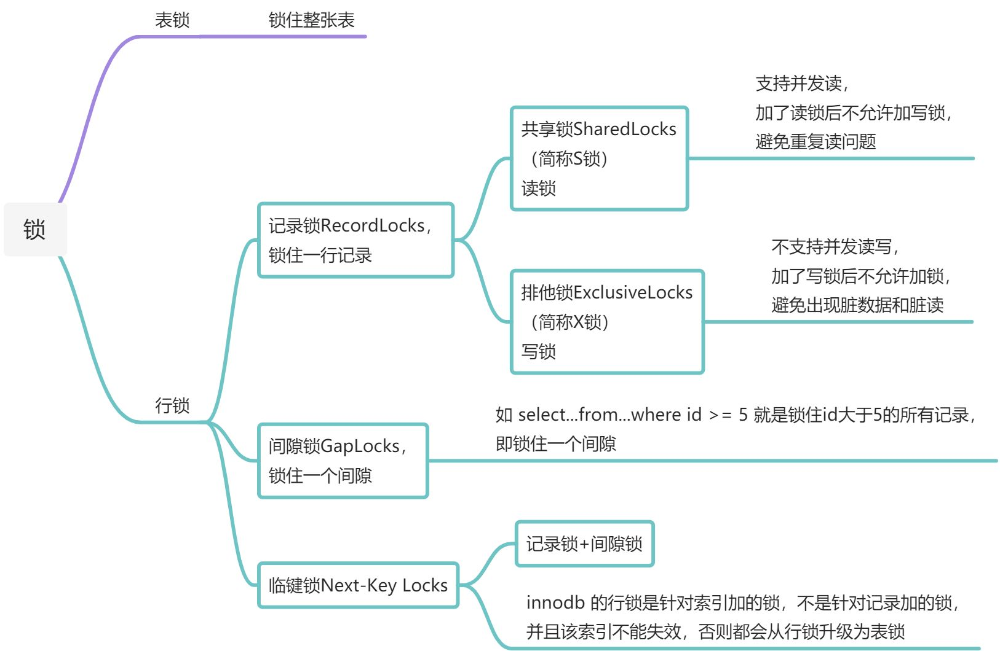

#### MySQL 锁的划分

- 按锁的属性划分：共享锁（S锁、读锁）、排他锁（X锁、写锁）
- 按锁的粒度划分：行级锁、表级锁、页级锁
- 按锁的状态划分：意向共享锁、意向排他锁

行级锁（锁的是索引记录，由以下三种实现）：

- 记录锁（Record Lock）：锁单条索引记录。触发条件：唯一索引（含主键）**等值查询且记录存在**。若等值查询**未命中**，则加间隙锁；若唯一索引**范围查询**（或联合唯一索引只用到部分列），则加临键锁
- 间隙锁（Gap Lock）：锁两条索引记录之间的**间隙**（含首条前、末条后的无穷间隙），区间**左开右开 (a, b)**，两端记录本身不锁，只阻止向间隙内插入。不同事务的间隙锁可以共存
- 临键锁（Next-Key Lock）：记录锁 + **该记录前面**的间隙，区间**左开右闭 (a, b]**。例：索引值 10、11、13、20，临键锁区间为 `(-∞,10]`、`(10,11]`、`(11,13]`、`(13,20]`、`(20,+∞)`

注意：间隙锁、临键锁只在 REPEATABLE READ 下使用；READ COMMITTED 下关闭（仅外键检查、唯一键检查时使用）

